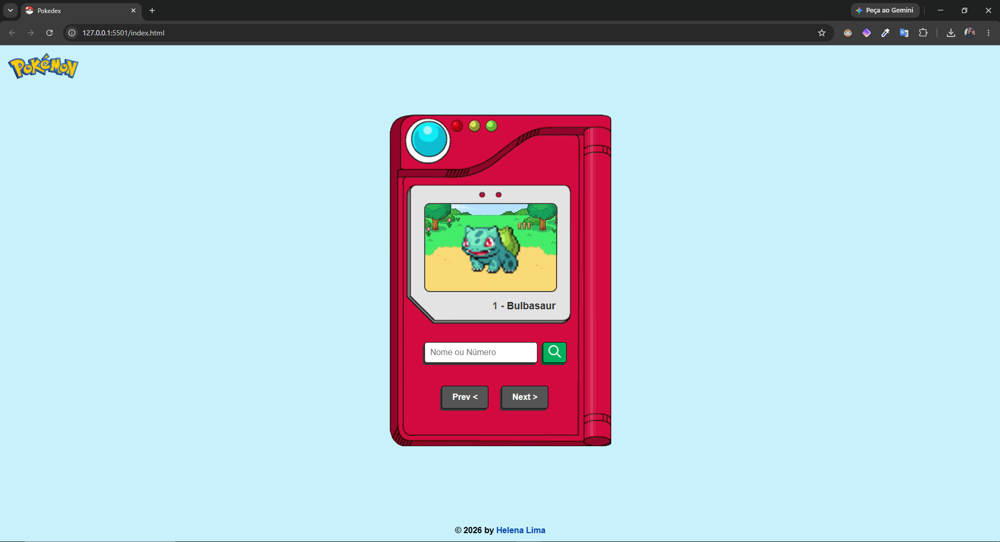

<h1 align="center">Pokédex</h1>

<p align="center">
  Uma Pokédex desenvolvida com HTML, CSS e JavaScript para consultar Pokémon por nome ou número a partir de uma API pública.
</p>

<p align="center">
  <a href="#-tecnologias">Tecnologias</a>&nbsp;&nbsp;&nbsp;|&nbsp;&nbsp;&nbsp;
  <a href="#-projeto">Projeto</a>&nbsp;&nbsp;&nbsp;|&nbsp;&nbsp;&nbsp;
  <a href="#memo-licença">Licença</a>
</p>

<p align="center">
  
</p>

<br>

<p align="center">
  
</p>

## 🚀 Tecnologias

- HTML5
- CSS3
- JavaScript
- PokéAPI

## 💻 Projeto

O projeto consiste em uma Pokédex desenvolvida para consultar e visualizar informações de Pokémon de forma simples e intuitiva.

A aplicação permite pesquisar o Pokémon pelo nome ou número, visualizar sua imagem e navegar entre diferentes Pokémon utilizando os botões **Prev** e **Next**. Também apresenta uma mensagem de erro quando a consulta não encontra um Pokémon.

As informações são obtidas por meio da [PokéAPI](https://pokeapi.co/), sendo necessária uma conexão com a internet para realizar as consultas.

- [Visite o projeto online]()

### Como executar

1. Clone este repositório:

   ```bash
   git clone <url-do-repositorio>
   ```

2. Abra a pasta do projeto no VS Code.
3. Abra o arquivo `index.html` no navegador ou utilize a extensão Live Server.

## 📚 Referência

O desenvolvimento deste projeto teve como referência o vídeo tutorial disponível no YouTube:

- [Vídeo utilizado](https://www.youtube.com/watch?v=SjtdH3dWLa8)

📝 Licença

Esse projeto está sob a licença MIT.

---

Feito com ♥ by Helena Lima
